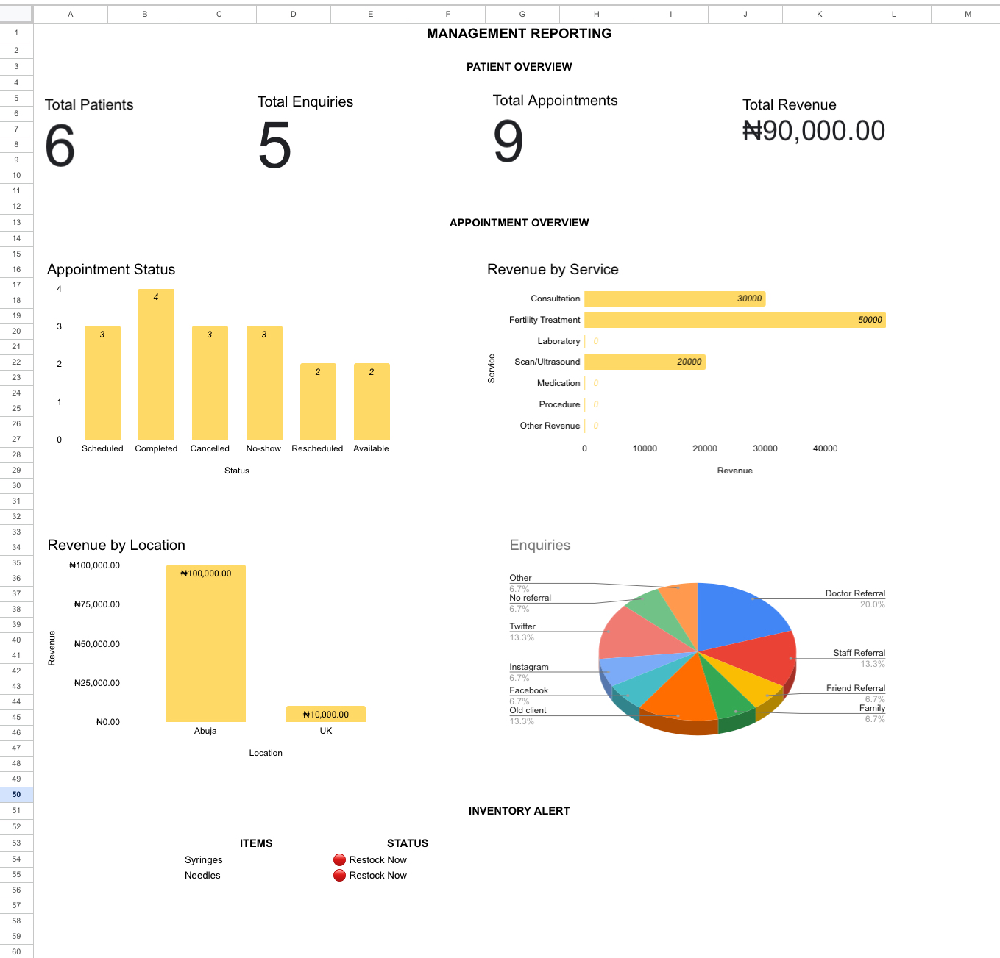

# Healthcare Practice Operations Tracking & Reporting System

A Google Sheets-based prototype for organising healthcare operations and turning operational records into management insights.

**Tools:** Google Sheets · Spreadsheet Automation · Data Validation · Operational Analytics · Dashboard Reporting

> **Portfolio project:** This is an independent prototype built with synthetic data and inspired by real-world healthcare operations. It was not commissioned by or implemented at any clinic.

## Dashboard Preview

## 1. Project Overview

Small healthcare practices manage several connected workflows, from patient registration and appointment scheduling to inventory and financial transactions. When these activities are recorded inconsistently across separate spreadsheets, maintaining reliable records and producing management reports can become time-consuming.

This project explores how a structured Google Sheets workbook can connect these operational workflows and automate routine calculations and reporting.

The prototype is designed around a simulated fertility practice operating across Abuja, Nigeria, and the United Kingdom.

**The objective:** demonstrate practical data modelling, spreadsheet automation, data quality control, and management reporting in a healthcare context.

## 2. Key Features

- **Patient and provider management:** Structured records, unique identifiers, standardised fields, and linked information.
- **Enquiry tracking:** Monitor enquiry sources, statuses, contact attempts, outcomes, and follow-up dates.
- **Scheduling and appointments:** Track provider availability, bookings, appointment details, and outcomes.
- **Inventory management:** Record stock purchases, usage, adjustments, calculate current stock, and flag replenishment needs.
- **Financial tracking:** Record revenue and expenses by category and location, with optional patient and appointment references.
- **Management dashboard:** KPI scorecards, appointment status, revenue by service, revenue by location, enquiries by source, and inventory alerts.

## 3. Workbook Architecture

The workbook contains 14 tabs organised into four functional layers.

| Layer | Tabs | Purpose |
|---|---|---|
| Foundation | Patients, Partners, Next of Kin, Providers, Reference Lists | Maintain core records and standardised reference values. |
| Patient Acquisition & Service Delivery | Enquiries, Enquiry Follow-up, Scheduling, Appointments, Appointment Follow-up | Track prospective patients, follow-ups, availability, and bookings. |
| Operational Resources & Finance | Medical Supplies, Inventory Transactions, Financial Transactions | Monitor stock movements, revenue, and expenses. |
| Management Insight | Management Reporting | Present summary metrics, charts, and inventory alerts. |

The design uses unique identifiers and references to connect related records instead of repeatedly entering the same information.

For example, appointment records reference patient and provider identifiers, while inventory balances are calculated from recorded stock movements.

## 4. Technical Implementation

The prototype demonstrates the following Google Sheets techniques:

- `ARRAYFORMULA` for automated identifiers and calculated columns.
- `XLOOKUP` for retrieving information from related records.
- `IF` for conditional calculations and status classification.
- `COUNTIF` and `SUMIF` for summary metrics.
- `SUMIFS` for multi-criteria financial reporting.
- `FILTER` for dynamically displaying inventory alerts.
- Data validation and dropdowns for standardised inputs.
- Conditional formatting and charts for visual reporting.

These techniques support consistent data entry, automated calculations, and reporting that updates as the underlying records change.

## 5. Dashboard & Reporting

The management reporting layer is designed to answer practical operational questions:

| Dashboard component | Business question |
|---|---|
| Patient and enquiry scorecards | How many patients and enquiries have been recorded? |
| Appointment scorecard and status chart | How many appointments are recorded, and what are their outcomes? |
| Revenue by service | Which service categories generate recorded revenue? |
| Revenue by location | How is recorded revenue distributed across locations? |
| Enquiries by source | Which channels are generating enquiries? |
| Inventory alerts | Which supplies need replenishment or attention? |

### Financial reporting consideration

Because Abuja transactions may be denominated in Nigerian naira (NGN) and UK transactions in pounds sterling (GBP), their amounts must not be combined into a single comparable monetary total without an appropriate currency-conversion method.

Currency-aware reporting is an identified refinement for the prototype.

## 6. Design Decisions & Lessons Learned

**Separating scheduling from appointments**

Provider availability and actual bookings represent different operational concepts. Keeping them separate makes the records easier to maintain and supports more meaningful reporting.

**Maintaining separate follow-up logs**

An enquiry or appointment may involve multiple contact attempts. Separate follow-up records preserve that history rather than overwriting earlier activity.

**Calculating inventory from transactions**

The system derives current stock from recorded purchases, usage, and adjustments. This provides a more traceable approach than manually overwriting stock balances.

**Investigating data quality issues**

During dashboard development, a revenue calculation returned zero even though the displayed transaction type appeared correct. Further testing identified a hidden trailing space that prevented an exact text match.

This reinforced an important lesson: a formula can be syntactically correct while inconsistent source values still produce incorrect results.

**Designing for analytical accuracy**

The revenue-by-location chart highlighted the need to account for different currencies. A visualisation rendering successfully does not automatically make the comparison meaningful.

## 7. Data Privacy & Limitations

All records used in this portfolio project are synthetic. No real patient data is included.

This is a working prototype for demonstrating spreadsheet-based operational tracking and reporting. It is not a production-ready clinical information system, electronic health record, or validated financial reporting platform.

Before any real-world deployment, the system would require appropriate assessment of data protection, access controls, auditability, backup procedures, workflow requirements, and financial reporting rules.

## 8. Future Improvements

Potential extensions include:

- Currency-aware financial reporting and conversion rules.
- Monthly operational trends and more advanced KPI analysis.
- Enquiry conversion and appointment no-show analysis.
- Improved data dictionary and system documentation.
- Automated data collection and workflow enhancements using Google Forms or Apps Script.

These are proposed improvements, not features claimed as completed.

## About This Project

This project forms part of my Healthcare BI and Data Analytics portfolio. It focuses on building the operational data structure behind useful reporting, rather than creating visualisations in isolation.

My broader portfolio explores healthcare analytics, SQL, Power BI, and data-driven operational improvement.
